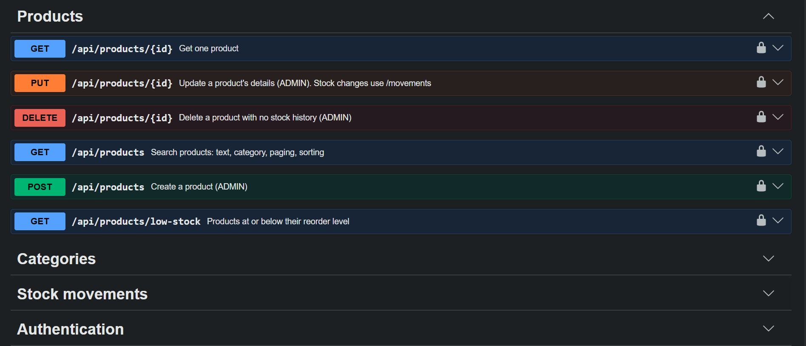
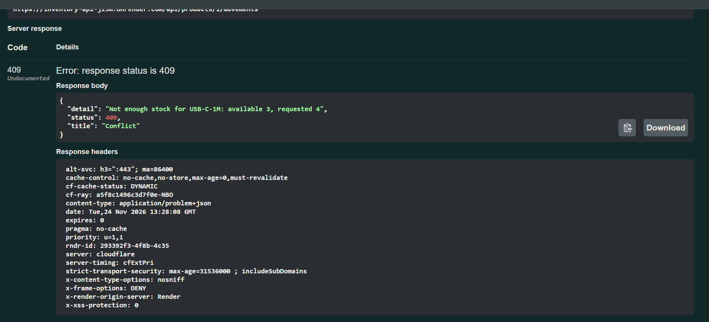

# Inventory REST API

> A Java and Spring Boot REST API that manages products, categories and stock movements. It uses JWT login with two roles, keeps its database schema in versioned migrations, prevents overselling with a row lock, and is checked by automated tests on every push.

<!-- LIVE-LINK -->
**Source code:** [github.com/AAchar-0/inventory-api](https://github.com/AAchar-0/inventory-api)
**Author:** [Anade A’Acharo](https://aachar-0.github.io/)

| Swagger documentation | A stock conflict (409) |
|---|---|
|  |  |

## Contents

- [Overview](#overview) 
- [Key features](#key-features)
- [Endpoints](#endpoints)
- [Design decisions](#design-decisions)
- [Tech stack](#tech-stack)
- [Project structure](#project-structure)
- [Run it locally](#run-it-locally)
- [Settings](#settings)
- [Testing](#testing)
- [Deployment](#deployment)
- [Limitations](#limitations)
- [Privacy and ethics](#privacy-and-ethics)
- [Technical reference](#technical-reference)
- [License and attribution](#license-and-attribution)

## Overview

A small shop needs to know what it has in stock, what is running low, and who changed what. This project answers those questions through a REST (Representational State Transfer) API, which means other programs, such as a website or a mobile app, can read and change the data through normal web requests.

I built it to show the parts that real backend work needs and that tutorials often skip. These are safe passwords, login with roles, correct error codes, a database that changes only through versioned scripts, and tests that run without any manual setup. The code has many comments on purpose, so I can read any file later and remember how it works.

## Key features

**Stock that stays correct**
- Every stock change is saved as a movement (`IN` or `OUT`) with a note and the user who made it, so the history of a product can always be checked.
- A pessimistic row lock and one database transaction per change mean two people selling the last item at the same time cannot both succeed.
- Selling more than what exists is refused with a `409 Conflict`, and the quantity never goes below zero.

**Login and permissions**
- Passwords are stored only as BCrypt hashes. The API signs a JWT (JSON Web Token) at login, and the token expires after 60 minutes.
- There are two roles. `ADMIN` can manage products and categories, and `STAFF` can read and record stock movements. Public registration can only create `STAFF`.
- A wrong username and a wrong password give the same message, so nobody can use the login to find out which usernames exist.

**Clean API behaviour**
- Search by text and category, with paging and sorting. Sorting is limited to a fixed list of fields, so users cannot ask the database to sort by anything they like.
- Input is validated, and errors use the standard RFC 7807 "problem details" format with a clear status code (400, 401, 403, 404 or 409).
- A low-stock report shows every product at or below its reorder level.

**Database and delivery**
- Flyway migrations create the tables, constraints and indexes, and Hibernate is not allowed to change the schema.
- The app starts with an in-memory H2 database and needs no setup. A `postgres` profile switches it to PostgreSQL.
- A `Dockerfile`, a `docker-compose.yml` file and a GitHub Actions workflow are included.

## Endpoints

| Method | URL | Who can use it | What it does |
|---|---|---|---|
| POST | `/api/auth/register` | everyone | Creates a `STAFF` account and returns a token |
| POST | `/api/auth/login` | everyone | Returns a token |
| GET | `/api/categories` | logged in | Lists categories |
| POST, PUT, DELETE | `/api/categories` and `/api/categories/{id}` | `ADMIN` | Creates, changes or removes a category |
| GET | `/api/products` | logged in | Searches products with `q`, `categoryId`, `page`, `size`, `sort` and `dir` |
| GET | `/api/products/low-stock` | logged in | Lists products at or below their reorder level |
| GET | `/api/products/{id}` | logged in | Returns one product |
| POST, PUT, DELETE | `/api/products` and `/api/products/{id}` | `ADMIN` | Creates, changes or removes a product |
| POST | `/api/products/{id}/movements` | logged in | Records stock coming in or going out |
| GET | `/api/products/{id}/movements` | logged in | Shows the movement history, newest first |

The file [`requests.http`](requests.http) contains a ready-made request for each of these. It works with the REST Client extension in VS Code.

## Design decisions

| Decision | Reason |
|---|---|
| Flyway owns the schema, and `ddl-auto` is `none` | Every database change is a reviewed file in Git, and Hibernate cannot change tables by accident. |
| Pessimistic lock on the product row | The simplest way to make two simultaneous sales safe. It is slower than other methods under heavy load, but it is easy to understand and correct. |
| DTOs (data transfer objects) written as Java records | The API shape is separate from the database tables, so a new database column never leaks into the JSON by mistake. |
| `@PreAuthorize` on the controller methods | The permission rule sits next to the code it protects, which makes it easy to review. |
| Sort fields from a fixed list | It stops users from sorting by internal or sensitive fields. |
| Secrets only from environment variables | Nothing secret is in the source code. A missing admin password makes the app create a random one and print it once. |
| H2 in PostgreSQL mode for local runs and tests | Anyone can run the project in a minute, without installing a database. |

## Tech stack

Java 21 · Spring Boot 4.2 · Spring MVC · Spring Data JPA and Hibernate · Spring Security 7 · JWT · Flyway · H2 and PostgreSQL · springdoc OpenAPI (Swagger UI) · JUnit 5 · Mockito · MockMvc · Maven · Docker · GitHub Actions

## Project structure

```
inventory-api
├── .github/workflows/ci.yml        Builds and tests on every push
├── docs/                           Reference sheets (start with 01-project-map.md)
│   └── screenshots/                Images used in this README
├── src/
│   ├── main/java/io/github/aachar0/inventoryapi/
│   │   ├── config/                 Settings, first admin account, Swagger details
│   │   ├── domain/                 Database entities and enums
│   │   ├── repository/             Database access interfaces
│   │   ├── service/                Business rules, transactions, locking
│   │   ├── web/                    Controllers and the global error handler
│   │   ├── dto/                    Request and response shapes
│   │   ├── security/               Token creation and the security filter chain
│   │   └── tour/                   JavaFeatureTour, a one-file Java refresher
│   ├── main/resources/db/migration/  V1 schema and V2 starter categories
│   └── test/                       Unit tests and one full flow test
├── CITATION.cff
├── Dockerfile
├── docker-compose.yml
├── LICENSE
├── pom.xml
├── requests.http
└── README.md
```

## Run it locally

You need JDK 21 and Maven 3.9 or newer. You do not need Docker or PostgreSQL.

1. Clone the project and set your own secrets (PowerShell):
   ```powershell
   git clone https://github.com/AAchar-0/inventory-api.git
   cd inventory-api
   $env:APP_ADMIN_PASSWORD = "choose-a-strong-password"
   $env:JWT_SECRET = "at-least-32-random-characters-go-here!!"
   ```
2. Build and test, then start the API:
   ```powershell
   mvn clean verify
   mvn spring-boot:run
   ```
3. Open [the local Swagger page](http://localhost:8080/swagger-ui.html), run `POST /api/auth/login` with the user `admin` and your password, copy the token, click **Authorize**, and paste it. Now you can try every endpoint from the page.

The data lives in memory, so it disappears when you stop the app.

## Settings

| Variable | Meaning |
|---|---|
| `APP_ADMIN_PASSWORD` | Password of the first `admin` account. If it is empty, a random one is printed once in the log. |
| `JWT_SECRET` | Key that signs the tokens. It needs at least 32 characters. |
| `SPRING_PROFILES_ACTIVE` | Set it to `postgres` to use PostgreSQL instead of H2. |
| `DB_URL`, `DB_USER`, `DB_PASSWORD` | PostgreSQL connection, used with the `postgres` profile. |
| `PORT` | HTTP port. The default is 8080. |

## Testing

```powershell
mvn clean verify
```

There are 15 tests. Unit tests check the stock rules, with Mockito standing in for the database. One test class checks the movement types, one runs the Java feature tour, and one full flow test registers a user, logs in, creates a product, sells stock, and checks the 403 and 409 cases through the real security filters. GitHub Actions runs the same command on every push.

## Deployment

The `Dockerfile` builds the app in one stage and runs it in a small second stage, as a user without admin rights. The public demo runs this image on [Render](https://render.com/) and keeps its data in a [Neon](https://neon.com/) PostgreSQL database, which is configured only through environment variables. The steps and the Docker commands for a local PostgreSQL are in [`docs/08-docker-and-postgres.md`](docs/08-docker-and-postgres.md).

## Limitations

- The automated tests use H2 in PostgreSQL mode, so a few behaviours that exist only in PostgreSQL are not covered by tests.
- Tokens cannot be cancelled before they expire, and there are no refresh tokens.
- There is no rate limit on login, so a real deployment would need one in front of it.
- Public registration is open on purpose, to keep the demo easy to try. A real shop would let only admins create accounts.
- The free hosting for the demo sleeps after 15 minutes without traffic, so the first request after a pause can take about a minute.
- Prices use one currency, and the project has no website or app in front of it. It is the backend only.

## Privacy and ethics

The project contains no real people or real business data. The starter categories are generic, and the sample requests use `example.com` addresses. The API stores only a username, an email address and a password hash for each account, and it never returns the hash. If you deploy it for real users, you become responsible for their data, so protect the database and the secrets accordingly.

## Technical reference

The `docs` folder has reference sheets for revisiting each part of the project: [project map](docs/01-project-map.md), [Java](docs/02-java-reference-sheet.md), [Spring Boot](docs/03-spring-boot-reference-sheet.md), [SQL](docs/04-sql-reference-sheet.md), [API reference sheet](docs/05-api-cheatsheet.md), [Git and GitHub guide](docs/06-git-and-github-guide.md), [troubleshooting](docs/07-troubleshooting.md) and [Docker and PostgreSQL](docs/08-docker-and-postgres.md).

## License and attribution

Released under the [MIT License](LICENSE). Reuse is welcome, and the license requires that the copyright notice stays with any copy or substantial portion of this work. Please credit it as:

> Anade A’Acharo, [Inventory REST API](https://github.com/AAchar-0/inventory-api)

GitHub's **Cite this repository** button (from [`CITATION.cff`](CITATION.cff)) gives ready-made citation formats. Presenting this work as your own, or removing the notice, is not permitted by the license.
